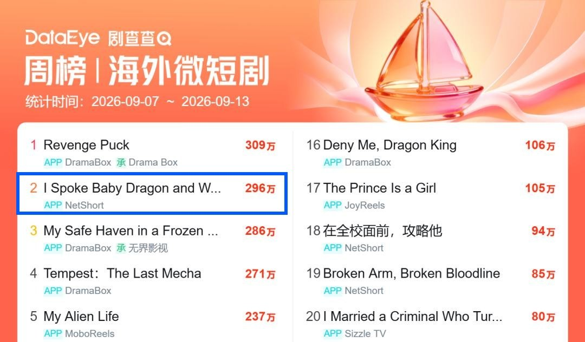
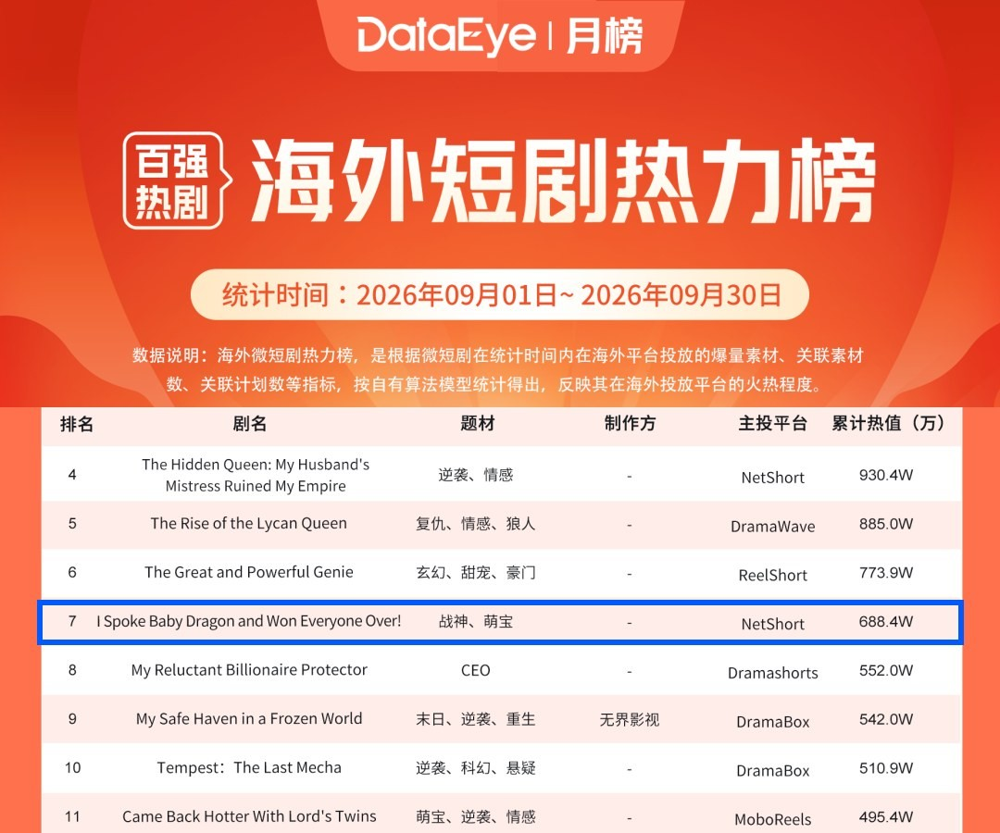

1. [S급 AI] THE VAMPIRE KING'S HUMAN NANNY

타이틀
- 영어 (English): The Vampire King's Human Nanny

담당 CM
- Rowan Lee

기본 정보
- [키아트 이미지 자리]
- 장르 : Romance / Comedy / Fantasy
- 키워드: Vampire, Nanny, Transmigration, Baby, Single Dad, Mind Reading
- 회차 (에피소드): 50화 / 무료 EP 1-9
- 로그라인:
  해가 뜨면 피를 바칠 인간 하녀로 뱀파이어 성에서 눈을 뜬 간호사 노라. 뱀파이어 왕 줄리안이 아기 왕자의 울음을 못 그치면 전부 죽는다고 한 그때, 노라 귀에만 아기의 속마음이 들린다. 노라는 피 대신 하루 금화 천 닢을 부르고, 육아는 하나도 모르는 왕의 단 하나뿐인 보모가 된다.
- 타겟층(국가, 남 or 여성향): 북미/글로벌 20-40 여성
- AI실사 or AI 애니: AI 실사
- 레퍼런스 (있다면):
  NetShort <I Spoke Baby Dragon and Won Everyone Over!>
  NetShort <The Mafia Bosses' Max-Level Nanny>

해당 IP 피칭 사유 (Core Expectation)
- 왜 제작해야하는지?
- 시장성이 있는지?
- 크리에이티브에 변별력이 있는지?
- 어떤 마케팅 셀링 포인트 (후킹한 광고소재)가 있는지?

[왜 제작해야 하는지? 시장성이 있는지?]
원작 NetShort <I Spoke Baby Dragon and Won Everyone Over!> 랭킹 1위, 같은 원작의 마피아판 NetShort <The Mafia Bosses' Max-Level Nanny> 랭킹 2위. 두 편 모두 NetShort에서 오래 1~2위.
원작은 DataEye 주간 첫 주 10위(유일한 신작), 다음 주 2위. 9월 월간 7위(실사 포함), 9월 신작 중 1위. AI 드라마.

비글루엔 아직 보모물이 없음.
무료 1~9화 · 10화 대본, 50화 트리트먼트 완료.
검증된 히트작 기반 + 뱀파이어 세계 + 아빠와 보모의 로맨스로, S급 제작이 필요.

[크리에이티브에 변별력이 있는지?]
원작은 아기 용의 말을 알아듣는 간호사가 용왕의 어린 동생을 살리며 왕궁의 마음을 얻는 이야기.
이 작품은 아기 속마음이 들리는 인간 보모가 뱀파이어 왕의 아들을 키우며 그 아빠의 마음까지 얻는 이야기.
아기와 남주의 관계 변경
레퍼런스: 아기 = 용왕의 어린 동생.
변경: 아기 = 왕비를 잃은 뱀파이어 왕의 아들. 아빠와 보모가 한 아기를 같이 키움.
드래곤에서 뱀파이어로 세계 변경
레퍼런스: 용왕의 왕궁, 아기 용.
변경: 뱀파이어 성, 새끼 박쥐로 변하는 아기. 피 대신 우유, 관 요람, 해에 닿으면 재가 되는 몸.
무료 회차 구성 및 엔딩 변경
레퍼런스: 무료 6화, 불길에서 끝.
변경: 무료 9화. 불길은 7화로, 9화는 붉은 연기에 아기 여섯의 몸이 변하기 시작하는 순간에서 끊음.
마피아판의 오르는 보모 급여도 가져옴: 일당 천 닢 → 이천 닢, 박쥐 한 번에 백 닢.
시그니처 소품
왕 반지 (5화 · 6화)
줄리안이 제 왕 반지를 빼 노라 손가락에 끼워 줌.
우유 수염 (4화 · 8화)
4화엔 노라가, 8화엔 붕대 감은 손의 줄리안이 먹인 우유.

[광고 소재]
레퍼런스 광고 1

64.7초. 목에 화염 구슬이 걸린 아기 → "Don't order him. Just call his name." → 불길.
이 작품 7화: 숨이 막힌 펠릭스 → 노라 "왕 말고, 아빠 목소리로 부르라고요!" → 무릎 꿇는 줄리안 → 박쥐 날개로 불 속에 날아드는 줄리안.
레퍼런스 광고 2

873초. 원작 1~6화 몰아보기. "The prince is just hungry. Hold him down!" → 아기 등에 박힌 핀 → 불길.
이 작품 1~7화: 우는 아기와 모래시계 → 가죽 기저귀 → 피 대신 우유 → 새끼 박쥐 → 왕 반지 → 불 속의 줄리안.
레퍼런스 광고 3

524초. 마피아판 2~6화 몰아보기. 아들의 웃음을 본 보스 → 주급 2만 달러 → 두 배 급여 → 브로치 "With this, anyone who touches you is declaring war on me."
이 작품 1~5화: 웃는 펠릭스를 보는 줄리안 → 일당 천 닢 → 이천 닢 → 왕 반지 "이 반지를 낀 이상, 네 목숨을 노릴 수 있는 건 오직 나뿐일 테니 안심해."
레퍼런스 광고 4

125.7초. 잠긴 놀이방 앞, 가정부에게 총을 겨누는 가문 부인들 → "They're children. All they need is gentle care." → "Override the lock now!"
이 작품 9~10화: 노라 "아기는 장식품이 아니에요." → 붉은 연기 → 해 뜨는 동쪽 창 밖으로 날아가는 아기 박쥐 여섯.

무료 회차: 시그니처 대사 + 관계 호칭
호칭: 펠릭스 → 노라 '누나' · 노라 → 줄리안 '폐하' · 줄리안 → 노라 '인간'.
1화: 우는 아기 왕자와 모래시계. 노라 귀에만 아기 속마음이 들림.
줄리안: "모래가 다 떨어지기 전까지 왕자가 울음을 그치지 않으면 전부 죽는다."
펠릭스(속마음): "엉덩이 따가워! 불난 것 같아!"
2화: 왕의 망토를 벗기고 하루 금화 천 닢에 보모가 됨.
노라: "당장 벗으세요."
줄리안: "무엄하다. 뭘 벗으라는 거냐!"
노라: "대신 일당은 금화 천 닢이요. 하루에!"
3화: 피를 거부하는 아기 왕자. 노라는 우유를 먹이자고 함.
줄리안: "뱀파이어 왕자에게 가축의 젖을 물리라고? 그건 왕실의 수치다."
노라: "체면은 애 살려놓고 차리셔도 안 늦습니다."
4화: 박쥐로 변한 펠릭스를 받다 떨어진 노라를 줄리안이 받아 안음.
줄리안: "오늘부터 왕자의 보모장은 이 인간이다. 일당은 두 배, 이천 닢."
노라: "아, 박쥐 출동은 별도예요. 한 번 잡을 때마다 백 닢."
5화: 동화 대신 전쟁 보고서를 읽어 주는 왕. 노라에게 왕 반지를 끼워 줌.
줄리안: "북쪽 사냥꾼 마을. 은 화살 이백 개, 마늘 수레 세 대. 처리 완료."
노라(속마음): "남자가 반지를 직접 끼워 주는 건 프러포즈 아니야?"
6화: 의식의 밤, 펠릭스가 성물 루비를 젤리인 줄 알고 삼킴.
줄리안: "반만 꺼."
아가사: "왕자님을 해치려고 사탕인 척 성물을 먹였다고요!"
7화: 왕이 무릎을 꿇고, 불길 속으로 박쥐 날개를 펴고 날아듦.
노라: "왕 말고, 아빠 목소리로 부르라고요!"
줄리안: "살려만 낸다면 뭐든 들어주겠다."
8화: 줄리안이 아들에게 직접 우유를 먹임. 비행 시험에서 펠릭스 등에 날개가 돋음.
노라: "직접… 먹이신 거예요?"
줄리안: "네가 하는 걸 봤다."
9화: 다섯 가문 아기를 혼자 맡은 노라. 해 뜨기 직전 붉은 연기가 아기들에게 닿음.
노라: "싫습니다. 아기는 장식품이 아니에요."
펠릭스(속마음): "나 코가 간질간질해. 몸이 이상해."

무료 회차 이후
① 원작에서 광고로 쓰인 장면 강화
해 뜨는 창으로 날아가는 박쥐 여섯 (10화) ★★
박쥐로 변한 아기 여섯이 해 드는 동쪽 창 밖으로 날아감. 줄리안이 그늘 끝에서 노라 손목을 잡음.
줄리안: "가지 마. 거긴 해가 든다."
노라: "저는 인간이에요. 해 따위 봐도 괜찮다고요."
탑 지붕 위 박쥐 구출 (유료 구간)
노라가 탑 지붕에서 아기 박쥐들을 받아 내고, 줄을 잡은 줄리안의 두 손이 햇빛에 재가 됨.
아가사: "마마, 꽃가루는 제가 넣었어요! 왕자님만은 살려 주세요!"
얼음탑 꼭대기 해 아래 구출 (유료 구간)
노라가 제 등으로 펠릭스의 햇빛을 가리고, 줄리안이 몸이 재가 되며 날아듦.
기디언: "나를 골라. 그럼 이 애한테 해는 안 보여 주지."
② 원작에 없는 추가 장면
왕의 여자 (유료 구간)
귀족 아가씨가 노라 드레스에 피를 쏟자 줄리안이 망토로 노라를 감쌈.
줄리안: "이 여자는 왕의 여자다. 넘보는 놈은 해 뜨는 탑에서 보자."
냄새가 똑같은 여자 (유료 구간)
노라가 죽은 왕비의 환생이라는 반전.
기디언: "냄새가 똑같군."
아기 왕자의 첫 말 (유료 구간) ★★
재가 된 줄리안 앞에서 펠릭스가 처음 입을 엶.
펠릭스: "엄마."

주요 인물 소개
노라 퀸 (여 / 26) · 인간 보모
간호사 면허 시험에 붙은 날 죽어, 해가 뜨면 피를 바칠 인간 하녀로 뱀파이어 성에서 눈을 뜬다. 아기 속마음이 들리는 건 노라뿐이다. 목숨이 걸린 순간에도 "대신 일당은 금화 천 닢이요. 하루에!"라며 값부터 부른다.

줄리안 (남) · 뱀파이어 왕
왕비를 잃은 뱀파이어 왕이자 펠릭스의 아빠. 우는 아들에게 모래시계를 뒤집고, 잠투정하는 아들에게 "북쪽 사냥꾼 마을. 은 화살 이백 개, 마늘 수레 세 대. 처리 완료."라고 전쟁 보고서를 읽어 준다.

펠릭스 (남 / 10개월) · 아기 왕자
울거나 겁에 질리면 새끼 박쥐로 변하는 아기 왕자. 노라를 처음 만난 날 "안 따가워… 누나 손 따뜻해."라며 누나라고 부른다.

아가사 (여) · 노라에게 밀려난 왕실 보모장
삼백 년 왕실 보모장. 노라에게 자리를 뺏기자 성물 루비를 펠릭스 앞으로 밀고, 진정 향을 붉은 꽃가루로 바꿔 넣는다. 노라만 보면 "왕실 법도상 즉결 처형입니다!"라고 외친다.

대비 (여) · 줄리안의 어머니
펠릭스의 할머니. 루비를 삼킨 왕자가 숨을 멈추자 "왕자를 죽인 저 인간을 지하 감옥에 처넣어라!"라고 명한다.

기디언 (남 / 천 살) · 북쪽 섬의 심판관 (유료 구간부터 등장)
열 달 전 왕비를 재로 만든 자. 노라 목덜미에 코를 대고 "냄새가 똑같군."이라고 말한다.

줄거리
간호사 노라 퀸은 해가 뜨면 피를 바칠 인간 하녀로 뱀파이어 성에서 눈을 뜬다. 뱀파이어 왕 줄리안이 열 달 된 아들 펠릭스의 울음이 안 그치면 전부 죽이겠다고 한 자리에서, 노라 귀에만 펠릭스의 속마음이 들린다. 노라는 하루 금화 천 닢에 보모가 되고, 줄리안은 제 왕 반지를 노라 손가락에 끼워 준다. 의식의 밤 루비를 삼킨 펠릭스를 노라가 살려 내고, 번진 불길 속으로 줄리안이 박쥐 날개를 펴고 날아든다. 다섯 가문 아기를 혼자 맡은 날, 해 뜨기 직전 아가사가 바꿔 넣은 붉은 꽃가루 연기가 아기들에게 닿는다.

박쥐로 변한 아기 여섯이 해 뜨는 창 밖으로 날아가고, 노라는 탑 지붕에서 아기들을 받아 낸다. 노라의 줄을 잡은 줄리안의 두 손은 햇빛에 재가 된다. 노라는 가문 아기들을 하나씩 지켜 가문들을 제 편으로 만들고, 줄리안은 귀족들 앞에서 노라를 왕의 여자라고 부른다.

북쪽 섬의 심판관 기디언은 노라에게서 열 달 전 자기가 재로 만든 왕비의 냄새를 맡는다. 노라는 펠릭스를 낳고 한 번도 안아 보지 못한 왕비가 다시 태어난 사람이었다. 기디언은 펠릭스를 빼앗아 해가 뜨는 얼음탑 꼭대기에 둔다. 노라는 제 등으로 햇빛을 가리고, 줄리안은 몸이 재가 되면서 기디언을 해 속으로 끌어낸다. 쓰러진 줄리안 앞에서 펠릭스가 처음 입을 연다. "엄마."

마지막 화에서 줄리안이 무릎을 꿇고 노라에게 왕비 반지를 끼운다. 노라가 왕비 일당은 얼마냐고 묻자 줄리안은 성 금고 전부라며 입을 맞춘다. 펠릭스가 두 번째 말을 한다. "아빠."

트리트먼트 (1화~Paywall 화)
- 회 별 엔딩 또는 클리프행어 알 수 있도록 작성
대본 : https://docs.google.com/document/d/1hwDfpSNA2OxsZILFwhKasaFFgi1IaH2RNTv8FX7dDVY/edit?tab=t.dt6athaa4wrh

EP1
핏빛 보름달이 뜬 밤, 뱀파이어 왕 줄리안이 자지러지게 우는 열 달 된 아들 펠릭스를 안고 모래시계를 뒤집으며, 모래가 다 떨어질 때까지 울음이 안 그치면 전부 죽이겠다고, 기다리기 지루하니 하나씩 먼저 죽이겠다고 한다. 그 손끝이 맨 먼저 가리킨 하녀는 간호사 면허 시험에 붙은 날 바나나 껍질을 밟고 죽었다가 이 성에서 눈을 뜬 노라 퀸이다. 끌려가던 노라 귀에만 펠릭스의 속마음이 들린다. "엉덩이 따가워! 불난 것 같아!" 노라가 벨벳 싸개를 풀자 가죽 기저귀 아래 엉덩이가 빨갛게 헐어 있고, 앞치마 면으로 감싸 토닥이자 펠릭스가 노라 손가락을 쥐고 웃는다. 웃는 아들을 보는 줄리안의 눈동자가 흔들린다.
엔딩 훅 삼백 년째 왕실 보모장 아가사가 노라에게 삿대질을 한다. "왕실 법도상 즉결 처형입니다!"

EP2
노라는 바닥의 가죽 기저귀를 아가사 코앞에 들이밀며 아기 엉덩이에 가죽을 채우면 다 짓무른다고 받아치고, 줄리안의 어머니 대비는 삼백 년 보모장도 소용이 없다고 차갑게 말한다. 아빠 품에 돌아간 펠릭스가 다시 자지러지자, 노라는 마늘 냄새 밴 줄리안의 전장 망토를 벗기고 줄리안은 그 망토를 태우라 명한다. 하늘 끝이 밝아 오고 피를 바칠 때가 된 인간 하녀들이 일제히 몸을 떨자 시녀들이 다시 노라를 끌고 가려 한다. 노라는 살려 두면 매일 이렇게 해 주겠다며 일당 금화 천 닢을 부르고, 줄리안은 아이를 키워 본 자가 이 성에 아무도 없다며 하루만 써 보겠다고 한다. 곧 시녀 열두 명이 순금 젖병을 받쳐 들고 들어오고, 젖병을 펠릭스 입에 물리려던 노라의 손이 멈춘다.
엔딩 훅 노라가 젖병 냄새를 한 번 더 맡는다. "설마… 진짜 피야?!"

EP3
아가사는 왕실 지하 창고에서 오백 년 묵힌 순혈 귀족 피라며 젖병을 낚아채 물리지만, 펠릭스는 고개를 돌리고 피가 싫다며 운다. 노라가 피 말고 우유를 먹여야 한다고 하자 귀족들은 깔깔 웃고, 줄리안은 가축의 젖은 왕실의 수치라고 한다. 노라가 체면은 애 살려 놓고 차리라고 맞서자, 줄리안은 실패하면 노라의 피를 짜서 먹이겠다며 딱 한 번을 허락한다. 서리 낀 젖병을 덥석 문 펠릭스는 우유를 노라 얼굴에 그대로 뿜고 더 크게 운다.
엔딩 훅 줄리안의 송곳니가 노라의 목덜미를 누른다. "인간의 말을 믿는 게 아니었는데. 기회는 끝났다."

EP4
눈을 질끈 감은 노라 귀에 우유가 너무 차가워 배가 얼었다는 펠릭스의 울음이 들린다. 노라는 젖병을 가슴에 품어 데우고 손목에 한 방울 떨어뜨려 본 뒤 다시 물리고, 병을 비운 펠릭스는 우유 수염을 단 채 까르르 웃는다. 아가사가 다시 피 젖병을 들이밀자 펠릭스는 새끼 박쥐로 변해 샹들리에에 매달리고, 의자를 쌓고 올라가 앞치마로 박쥐를 받은 노라가 떨어지는 순간 줄리안이 받아 안는다. 줄리안은 홀 전체에 대고 이 인간을 보모장으로 앉히고 일당을 이천 닢으로 올린다.
엔딩 훅 노라가 박쥐 출동은 따로라며 "한 번 잡을 때마다 백 닢."이라고 손가락 하나를 들자, 줄리안의 입꼬리가 살짝 올라간다.

EP5
그 새벽, 관 요람 위에 왕비 초상화가 걸린 방에서 펠릭스는 자면 아빠가 떠난다며 눈을 부릅뜨고 버틴다. 늘 하던 대로 요람 뚜껑을 닫으려는 줄리안을 노라가 손바닥으로 막고 동화를 읽어 달라고 하자, 줄리안은 사냥꾼 마을 습격 보고서를 또박또박 읽고 펠릭스는 두 사람의 검지를 하나씩 쥐고 잠든다. 줄리안은 모든 가문이 모이는 촛불 의식의 밤에 왕자를 안고 나설 노라를 가문마다 노릴 거라며, 제 왕 반지를 빼 노라 손가락에 직접 끼워 준다. 그날 노라는 잠든 펠릭스에게서 촛불이 뜨거워 싫다는 잠꼬대를 듣는다.
엔딩 훅 노라가 촛대를 요람에서 멀리 밀어 놓는다. "아기가 촛불을 무서워하는데, 촛불을 밝히는 의식의 밤을 치르겠다고…?"

EP6
촛불 천 개가 타오르는 의식의 밤, 노라는 검지에 왕 반지를 끼고 떠는 펠릭스를 안은 채 단상 위에 선다. 노라가 촛불을 꺼 달라고 하자 귀족들은 인간 하녀가 끄라 마라 한다고 비웃고, 줄리안은 반만 끄게 한다. 대비가 왕자의 자격을 증명할 성물 루비 쟁반을 내놓자 노라가 아기는 손에 잡히는 건 일단 입에 넣는다며 귀족들과 언성을 높이는 사이, 아가사가 쟁반을 슬쩍 민다. 펠릭스는 가장 큰 루비를 젤리인 줄 알고 삼키고, 작은 몸이 굳으며 숨이 멎는다.
엔딩 훅 아가사가 "왕자님을 해치려고 사탕인 척 성물을 먹였다고요!"라며 노라를 가리키자, 줄리안의 눈빛이 흔들린다.

EP7
줄리안은 성문을 전부 닫으라 명하고, 치유사가 고개를 젓자 대비는 노라를 지하 감옥에 처넣으라고 한다. 끌려가던 노라 귀에 젤리가 목에 꼈다는 펠릭스의 가냘픈 목소리가 들린다. 아가사는 뱀파이어 목의 숨구멍 두 개가 다 조용하다고 비웃고, 노라는 하나만 막혀 소리만 안 나는 거라고 맞선다. 줄리안이 당장 살려 내라고 하자, 노라는 펠릭스를 팔뚝에 엎어 등을 내리친다. 명령하듯 이름을 부르던 줄리안은 "왕 말고, 아빠 목소리로 부르라고요!"라는 외침에 한쪽 무릎을 꿇고 아들의 작은 손을 감싸고, 펠릭스 입에서 루비가 튀어나온다. 그 루비가 촛대를 쓰러뜨리자 불길이 노라와 펠릭스를 에워싸고, 불에 닿은 귀족의 손이 잿가루로 부서진다.
엔딩 훅 줄리안의 눈동자가 핏빛으로 번뜩이고, 등에서 거대한 검은 박쥐 날개가 펼쳐지며 불길 속으로 날아 들어간다.

EP8
줄리안은 손등이 그을린 채 펠릭스를 감싼 노라를 통째로 안고 불길을 나오고, 노라는 펠릭스부터 토닥이다 쓰러진다. 노라가 깨어난 방에서는 우유 수염을 단 펠릭스가 웃고 있고, 붕대 감은 손의 줄리안이 빈 우유병을 들고 있다. "네가 하는 걸 봤다." 다음 날 밤 모든 가문이 모인 야외 탑에서 울다 박쥐로 변하면 실격인 왕자의 비행 시험이 열린다. 아가사가 펠릭스와 서쪽 가문 딸 릴리를 횃대 끝 철심에 매달자, 노라는 못 나는 게 아니라 다들 쳐다봐서 무서운 거라며 두 아기를 내려 까꿍 놀이를 한다. 웃던 두 아기 등에서 손바닥만 한 박쥐 날개가 돋아 탑 위를 날고, 대비는 왕자의 자격을 확인했다며 시험을 마친다.
엔딩 훅 관람석 구석에서 아가사가 움켜쥔 비단 주머니 틈으로 붉은 가루가 새어 나온다.

EP9
아가사는 펠릭스와 함께 날았던 릴리까지 다섯 가문 아기를 노라에게 맡기며, 귀족들이 인간을 못 믿으니 피로연 날 하나라도 울면 노라도 끝이라고 한다. 노라는 아기들 속마음을 듣고 하나씩 달래고, 샘나서 우는 펠릭스에게 형아 노릇을 맡긴다. 줄리안이 훌쩍이는 휴고를 안아 올리자 울음이 뚝 그치고, 아기를 하나씩 안은 두 사람 어깨가 닿는다. 대비가 아기들을 얌전하게 할 향을 내밀자 노라는 울면 달래면 된다며 거절한다. 사흘 뒤 해 뜨기 직전, 해에 닿으면 재가 되는 뱀파이어들 연회장에 동쪽 창이 활짝 열렸고 하녀가 향로에 불을 붙인다. 아가사가 몰래 바꿔 넣은 붉은 꽃가루 연기가 아기들에게 닿자, 릴리가 코를 찡긋하고 테오가 재채기하고, 올리버의 송곳니가 길어지며 미아와 휴고의 등이 꿈틀거린다.
엔딩 훅 펠릭스가 노라를 돌아보고, 겁먹은 속마음이 들린다. "나 코가 간질간질해. 몸이 이상해."
