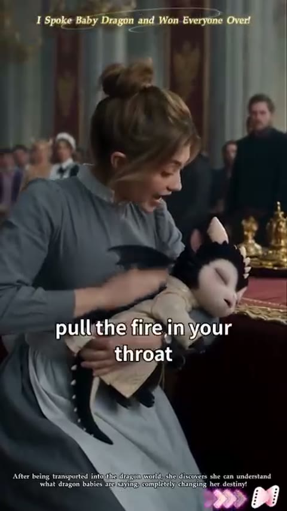
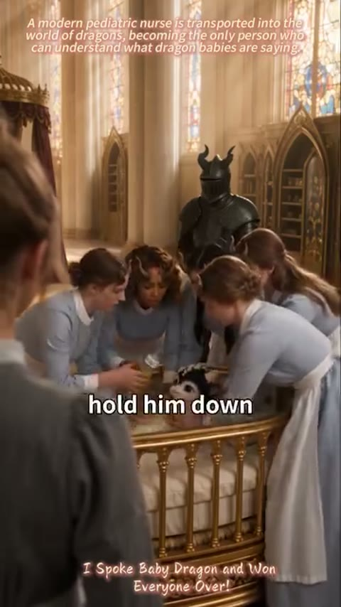
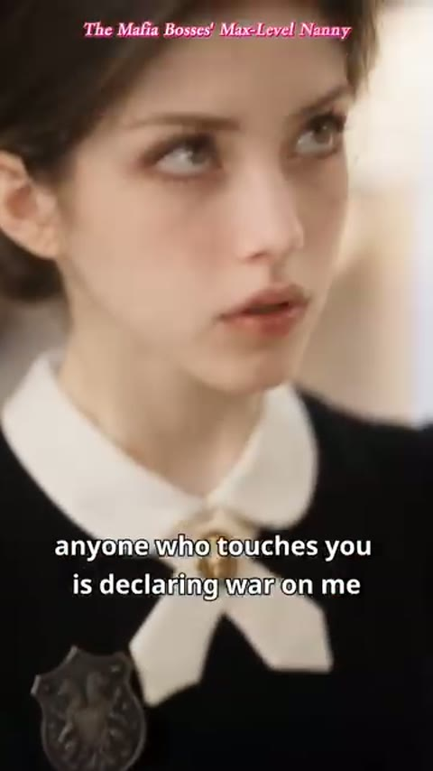

1. [S급 AI] THE VAMPIRE KING'S HUMAN NANNY

타이틀
- 영어 (English): The Vampire King's Human Nanny

담당 CM
- Rowan Lee

기본 정보
- [키아트 이미지 자리]
- 장르 : Romance / Comedy / Fantasy
- 키워드: Vampire, Nanny, Transmigration, Baby, Single Dad, Mind Reading
- 회차 (에피소드): 50화 / 무료 EP 1-9
- 로그라인:
  해가 뜨면 피를 바쳐야 하는 인간 하녀의 몸으로 뱀파이어 성에서 눈을 뜬 간호사가, 아기의 속마음을 듣는 능력으로, 아무도 못 달래던 최강 뱀파이어 왕의 아기 왕자를 달래 단 하나의 보모가 되고, 끝내 그 왕의 왕비가 되는 이야기.
- 타겟층(국가, 남 or 여성향): 북미/글로벌 20-40 여성
- AI실사 or AI 애니: AI 실사
- 레퍼런스 (있다면):
  NetShort <I Spoke Baby Dragon and Won Everyone Over!>
  NetShort <The Mafia Bosses' Max-Level Nanny>

해당 IP 피칭 사유 (Core Expectation)
- 왜 제작해야하는지?
- 시장성이 있는지?
- 크리에이티브에 변별력이 있는지?
- 어떤 마케팅 셀링 포인트 (후킹한 광고소재)가 있는지?

[왜 제작해야 하는지? 시장성이 있는지?]
레퍼런스는 원작 NetShort <I Spoke Baby Dragon and Won Everyone Over!>와 마피아판 NetShort <The Mafia Bosses' Max-Level Nanny> 두 편.
두 레퍼런스 모두 NetShort에서 오래 1~2위를 한 작품임.
원작은 NetShort 랭킹 1위 기록.
마피아판은 같은 원작을 마피아 세계로 바꾼 리메이크임. NetShort 랭킹 2위 기록.
같은 원작이 두 번 히트함. 소재가 두 번 검증됨.
DataEye 해외 숏드라마 주간 순위에서 원작은 첫 주 10위. 그 주 순위에 든 유일한 신작임.
다음 주 2위.
DataEye 9월 월간 순위(실사 포함 전체) 7위. 9월 신작 중 1위.
DataEye는 원작을 AI 드라마로 분류함.
[스크린샷 표: 9/7~9/13 DataEye 주간 기준 | 9월 DataEye 월간 기준]
비글루엔 아직 보모물이 없음. 타 플랫폼에선 크게 히트하고 유행 중인 소재임.
이 작품의 아기 왕자 펠릭스는 10개월 아기. 실사 촬영이 어려운 나이임.
무료 회차에서 아기가 새끼 박쥐로 변하고 등에 날개가 돋음. 박쥐 떼, 불길, 재가 되는 몸도 나옴. AI 제작에 맞는 장면들임.
원작도 AI 드라마로 히트한 작품임.
무료 1~9화 대본 완료. 유료 첫 화(10화) 대본 나옴. 50화 트리트먼트 완료.
검증된 히트작 기반 + 뱀파이어 세계 + 아빠와 보모의 로맨스로, S급 제작이 필요.

[크리에이티브에 변별력이 있는지?]
원작은 아기 용의 말을 알아듣게 된 간호사가 용왕의 열 달 된 어린 동생을 살리며 왕궁 모두의 마음을 얻는 이야기.
이 작품은 아기 왕자의 속마음이 들리는 인간 보모가 왕비를 잃은 뱀파이어 왕의 열 달 된 아들을 달래며 그 아빠의 마음까지 얻는 이야기.
아기와 남주의 관계 변경
레퍼런스: 원작 아기 왕자는 용왕의 어린 동생. 마피아판은 이 자리를 보스의 아들로 바꿈.
변경: 펠릭스를 뱀파이어 왕 줄리안의 아들로 바꿈. 왕비를 잃은 아빠와 보모가 한 아기를 같이 돌보는 육아 로맨스가 1화부터 시작됨. 1화에서 웃는 아들을 보는 줄리안의 눈동자가 흔들림. 5화 왕비 초상화가 걸린 방에서 줄리안이 노라 손가락에 왕 반지를 직접 끼워 줌. 7화에서 왕이 귀족들 앞에서 한쪽 무릎을 꿇고 노라 팔 위의 아들 손을 감쌈.
드래곤에서 뱀파이어로 세계 변경
레퍼런스: 용왕의 왕궁. 아기 왕자는 아기 용.
변경: 뱀파이어 왕국으로 바꿈. 세계가 바뀌어서 새로 생긴 장면을 넣음. 2화 마늘 냄새 밴 아빠 망토. 3~4화 피 대신 우유. 4화 샹들리에에 매달린 새끼 박쥐. 5화 관 요람 뚜껑. 7화 불에 닿으면 재가 되는 몸과 줄리안의 박쥐 날개. 9화 해에 닿으면 재가 되는 뱀파이어들 앞에 활짝 열린 동쪽 창.
무료 회차 구성 및 엔딩 변경
레퍼런스: 원작 무료는 6화. 무료 마지막 화가 불길에서 끝남.
변경: 불길은 7화 끝으로 옮김. 8화 야외 탑 첫 비행 시험과 9화 아기 다섯 돌보기를 추가. 마피아판 광고에 쓰인 다섯 가문 아기 장면을 9화에 넣어, 무료 마지막 화의 위험이 아기 하나에서 여섯으로 커짐. 무료 마지막 화(9화)는 해 뜨기 직전, 붉은 연기를 맡은 아기들 몸이 하나씩 변하기 시작하는 순간에서 끊음.
펠릭스(속마음): "나 코가 간질간질해. 몸이 이상해."
마피아판에서 보모 급여가 계속 오르는 재미도 가져옴. 일당 천 닢이 보모장 이천 닢으로 오르고, 박쥐를 한 번 잡을 때마다 백 닢이 따로 붙음.
시그니처 소품
왕 반지 (5화 · 6화)
5화에서 줄리안이 제 손가락의 왕 반지를 빼 노라 손가락에 직접 끼워 줌. 6화 의식의 밤, 그 반지를 검지에 끼운 노라가 단상 위에 섬.
대사 없이 반지를 끼우는 손 클로즈업 한 컷이면 두 사람이 가까워지는 게 보임. 숏폼 광고 클립으로 쓰기 좋음.
우유 수염 (4화 · 8화)
4화 펠릭스가 노라가 데운 우유를 먹고 우유 수염을 단 채 까르르 웃음. 8화에는 붕대 감은 손의 줄리안이 직접 먹인 우유 수염.
4화엔 노라가, 8화엔 아빠가 먹인 우유 수염. 아기 얼굴 한 컷이라 광고 첫 장면으로 쓰기 좋음.

[광고 소재]
레퍼런스 광고 1

64.7초. 클라이맥스로 바로 여는 광고.
원작 아기 왕자 목에 화염 구슬이 걸린 순간 → "Don't order him. Just call his name." → "…, it's your brother. Come back." → 불길 → "…answer me!" 순서.
이 작품은 같은 자리에 7화를 넣음.
숨구멍이 막힌 펠릭스 → 노라 "왕 말고, 아빠 목소리로 부르라고요!" → 무릎 꿇는 줄리안 → 튀어나온 루비 → 불길 → 박쥐 날개로 불 속에 날아드는 줄리안.
형태와 순서는 그대로 둠. 동생을 아들로 바꿈. 왕이 불길 앞으로 달려가 이름만 부르던 장면은 박쥐 날개로 불 속에 날아드는 장면으로 바꿈.
원래 대사 "Don't order him. Just call his name." 자리에 노라: "왕 말고, 아빠 목소리로 부르라고요!"
레퍼런스 광고 2

873초(약 14분 30초). 원작 무료 1~6화를 이어 붙인 광고.
첫 대사 "The prince is just hungry. Hold him down!" → 아기 등에 박힌 핀 → 불길 순서.
이 작품은 1~7화를 같은 순서로 줄여 넣음.
우는 아기와 모래시계 → 가죽 기저귀 → 마늘 망토 → 피 대신 우유 → 새끼 박쥐 → 왕 반지 → 루비 → 날개로 불 속에 날아드는 줄리안.
등에 박힌 핀 자리에 왕실 문장이 새겨진 가죽 기저귀를 넣음.
원래 첫 대사 자리에 줄리안: "모래가 다 떨어지기 전까지 왕자가 울음을 그치지 않으면 전부 죽는다."
레퍼런스 광고 3

524초. 마피아판 2~6화를 이어 붙인 광고.
보스가 아들의 웃음을 봄 → 빚 탕감과 주급 2만 달러 → 가정부에게 협조 지시 → 우유 온도 규칙 → 보모장과 두 배 급여 → 브로치 "With this, anyone who touches you is declaring war on me." → 잠긴 놀이방 순서.
이 작품은 1~5화가 같은 순서임.
1화 웃는 펠릭스를 보는 줄리안 → 2화 일당 천 닢 → 3~4화 차가운 우유와 데운 우유 → 4화 보모장 이천 닢과 박쥐 백 닢 → 5화 왕 반지.
브로치를 왕 반지로 바꿈.
브로치 대사 자리에 줄리안: "이 반지를 낀 이상, 네 목숨을 노릴 수 있는 건 오직 나뿐일 테니 안심해."
레퍼런스 광고 4

125.7초. 잠긴 놀이방 철문 앞에서 가문 부인들이 가정부에게 총을 겨누는 장면으로 여는 광고.
마피아판 여주 "Forget mob pride… They're children. All they need is gentle care." → 가정부가 씌운 누명 → "Override the lock now!" 순서.
이 작품은 9화와 10화를 같은 자리에 넣음.
노라 "아기는 장식품이 아니에요." → 다섯 가문 아기와 펠릭스 → 붉은 연기 → 10화 아가사 "대비께서 시키신 진정 향이에요." → 박쥐로 변해 동쪽 창 밖 해 뜨는 하늘로 날아가는 아기 여섯.
잠긴 놀이방을 해가 드는 동쪽 창으로 바꿈.
가정부 누명 자리에 아가사: "인간이 애들 하나 제대로 못 다뤄서 이 꼴이 난 걸, 어디서 향 탓을 해?"
P.S. 추론이나, 10개월 아기 클로즈업과 박쥐 변신 컷은 AI 제작이라 광고용으로 여러 판을 뽑기 쉬움.

무료 회차: 시그니처 대사 + 관계 호칭
펠릭스는 1화부터 노라를 '누나'라고 부름. 노라는 1화부터 줄리안을 '폐하'라고 부름. 줄리안은 노라를 '인간'이라고 부름(3화 · 4화 대사, 5화 줄리안 속마음). 펠릭스에게 줄리안은 아빠. 유료 구간에서 펠릭스가 처음 입으로 하는 말은 "엄마".
1화: 핏빛 보름달 아래 우는 아기 왕자와 모래시계. 노라 귀에만 아기 속마음이 들림.
줄리안: "모래가 다 떨어지기 전까지 왕자가 울음을 그치지 않으면 전부 죽는다."
펠릭스(속마음): "엉덩이 따가워! 불난 것 같아!"
노라: "네, 폐하. 대신 성공하면 저 살려 주시는 거예요."
2화: 가죽 기저귀를 따지던 노라가 마늘 냄새 밴 왕의 망토까지 벗기고, 하루 금화 천 닢에 보모로 고용됨.
노라: "당장 벗으세요."
줄리안: "무엄하다. 뭘 벗으라는 거냐!"
노라: "대신 일당은 금화 천 닢이요. 하루에!"
3화: 오백 년 묵힌 순혈 귀족 피를 거부하는 아기 왕자. 노라는 피 대신 우유를 먹이자고 함.
펠릭스(속마음): "피 싫어! 먹으면 배 꾸륵꾸륵 아파. 하얀 거, 하얀 거 먹을래!"
줄리안: "뱀파이어 왕자에게 가축의 젖을 물리라고? 그건 왕실의 수치다."
노라: "체면은 애 살려놓고 차리셔도 안 늦습니다. 저 마른 입술 좀 보세요."
4화: 우유 수염을 단 펠릭스가 까르르 웃음. 샹들리에의 새끼 박쥐를 받다 떨어진 노라를 줄리안이 받아 안음.
줄리안: "오늘부터 왕자의 보모장은 이 인간이다. 일당은 두 배, 이천 닢."
노라: "아, 박쥐 출동은 별도예요. 위험수당이랄까? 한 번 잡을 때마다 백 닢."
5화: 동화 대신 전쟁 보고서를 읽어 주는 왕. 잠든 펠릭스 옆에서 왕 반지를 끼워 줌.
줄리안: "북쪽 사냥꾼 마을. 은 화살 이백 개, 마늘 수레 세 대. 처리 완료."
줄리안: "이 반지를 낀 이상, 네 목숨을 노릴 수 있는 건 오직 나뿐일 테니 안심해."
노라(속마음): "남자가 반지를 직접 끼워 주는 건 프러포즈 아니야?"
6화: 촛불 천 개가 켜진 의식의 밤. 아가사가 밀어 놓은 성물 루비를 펠릭스가 젤리인 줄 알고 삼킴.
줄리안: "반만 꺼."
노라: "이 나이 애들한텐 성물이나 양말이나 똑같아요."
아가사: "왕자님을 해치려고 사탕인 척 성물을 먹였다고요!"
7화: 노라만 펠릭스의 목소리를 들음. 왕이 무릎을 꿇음. 불길 속으로 박쥐 날개를 펴고 날아드는 줄리안.
노라: "왕 말고, 아빠 목소리로 부르라고요!"
줄리안: "살려만 낸다면 뭐든 들어주겠다."
8화: 붕대 감은 손으로 아들에게 직접 우유를 먹인 줄리안. 다음 날 밤 비행 시험에서 노라의 까꿍 한 번에 펠릭스 등에 날개가 돋음.
노라: "직접… 먹이신 거예요?"
줄리안: "네가 하는 걸 봤다."
노라: "오늘은 시험 없어. 누나랑 놀자."
9화: 다섯 가문 아기를 혼자 맡은 노라. 줄리안이 안아 올린 아기는 울음을 뚝 그치고 얼어붙음. 해 뜨기 직전 활짝 열린 동쪽 창 앞에서 향로의 붉은 연기가 아기들에게 닿음.
줄리안: "겁먹은 게 아니라 존경하는 거다."
노라: "싫습니다. 아기는 장식품이 아니에요."
펠릭스(속마음): "나 코가 간질간질해. 몸이 이상해."

무료 회차 이후
① 원작에서 광고로 쓰인 장면 강화
해 뜨는 창으로 날아가는 박쥐 여섯 (10화) ★★
붉은 연기를 마신 아기 여섯이 박쥐로 변해 해가 드는 동쪽 창 밖으로 날아감. 마피아판 잠긴 놀이방 장면을 해 뜨는 창으로 바꾸고, 그늘 끝에서 노라 손목을 잡는 줄리안을 더함.
줄리안: "가지 마. 거긴 해가 든다."
노라: "저는 인간이에요. 해 따위 봐도 괜찮다고요."
광고 포인트: 해 속으로 날아가는 아기 박쥐 여섯과 인간 보모의 손목을 붙잡는 왕
탑 지붕 위 박쥐 구출 (유료 구간)
노라 혼자 탑 지붕으로 나가 한 마리에 백 닢이라고 세며 앞치마로 박쥐 넷을 받고, 커튼 줄을 허리에 감고 처마 그늘에 마지막까지 매달린 펠릭스와 릴리를 품에 안음. 줄리안은 그늘 끝에서 그 줄을 당기다 햇빛에 든 두 손이 손끝부터 재가 됨. 원작 불길 구출 장면을 해 아래 구출로 한 번 더 키움.
아가사: "마마, 꽃가루는 제가 넣었어요! 왕자님만은 살려 주세요!"
광고 포인트: 해에 닿아 손끝부터 재가 되는 왕의 두 손
얼음탑 꼭대기 해 아래 구출 (유료 구간)
반년 만에 해가 뜨는 새벽, 노라 혼자 얼음탑에 올라 검은 돛과 제 등으로 펠릭스를 가림. 연기를 끌며 날아든 줄리안이 북쪽 섬 심판관 기디언을 해 한가운데로 끌어냄. 원작 불길 구출 장면을 왕의 몸이 재가 되는 해 속 구출로 바꿈.
기디언: "나를 골라. 그럼 이 애한테 해는 안 보여 주지."
광고 포인트: 제 몸이 재가 되면서 해 속으로 날아드는 왕
② 원작에 없는 추가 장면
로지의 심장 소리와 왕의 여자 (유료 구간)
보모 마흔 명을 물어뜯은 바다 가문 아기 로지를 노라가 제 가슴에 안아 심장 소리로 재움. 대비의 조카 스칼렛이 노라 드레스에 피를 쏟자 줄리안이 망토로 노라를 감쌈.
펠릭스(속마음): "누나 심장 소리, 엄마 배 속에서 듣던 거랑 똑같아."
줄리안: "이 여자는 왕의 여자다. 넘보는 놈은 해 뜨는 탑에서 보자."
광고 포인트: 눈이 붉어진 귀족들 앞에서 인간 보모를 망토로 감싸는 왕
냄새가 똑같은 여자 (유료 구간)
반년 동안 해가 안 뜨는 북쪽 섬 부두에서 천 살 심판관 기디언이 노라 목덜미 냄새를 맡음. 열 달 전 죽은 왕비가 노라로 다시 태어났다는 사실이 여기서부터 드러남.
기디언: "냄새가 똑같군."
기디언: "아기들이 너한테만 말을 하지?"
광고 포인트: 인간 보모가 죽은 왕비였다는 반전
아기 왕자의 첫 말 (유료 구간) ★★
햇빛에 손과 뺨이 재가 된 줄리안 앞에서 펠릭스가 속마음이 아니라 입으로 처음 말을 함. 50화 왕비 반지 장면에서 두 번째 말이 이어짐.
펠릭스: "엄마."
펠릭스: "아빠."
광고 포인트: 열 달 아기의 첫 말과 세 식구가 되는 순간

주요 인물 소개
노라 퀸 (여 / 26) · 인간 보모
간호사 면허 시험에 붙은 날 바나나 껍질을 밟고 죽은 뒤, 해가 뜨면 피를 바쳐야 하는 인간 하녀의 몸으로 뱀파이어 성에서 눈을 뜬다. 성에서 아기들의 속마음이 들리는 사람은 노라뿐이다. 왕 앞에서 목숨이 걸린 순간에도 "대신 일당은 금화 천 닢이요. 하루에!"라며 값부터 부른다. 유료에서는 노라가 열 달 전 재가 된 왕비였다는 사실이 드러나고, 노라는 줄리안에게 왕비 반지를 받는다.

줄리안 (남) · 뱀파이어 왕
왕비를 잃은 뱀파이어 왕이자 열 달 된 펠릭스의 아빠다. 우는 아들 앞에서 모래시계를 뒤집고 다 죽이겠다고 할 만큼 아이를 다룰 줄 모르고, 잠투정하는 아들에게 읽어 주는 것도 "북쪽 사냥꾼 마을. 은 화살 이백 개, 마늘 수레 세 대. 처리 완료."라는 전쟁 보고서다. 그런 왕이 아빠 목소리로 부르라는 노라의 말에 모두 앞에서 무릎을 꿇는다. 유료에서는 노라와 펠릭스를 지키려고 두 번이나 햇빛에 손이 재가 되고, 무릎을 꿇고 노라에게 왕비 반지를 끼운다.

펠릭스 (남 / 10개월) · 아기 왕자
줄리안의 아들이자 뱀파이어 성에 오백 년 만에 태어난 아기 왕자다. 엉덩이가 따갑고 우유가 차갑고 촛불이 무섭다는 속마음이 노라 귀에만 들리고, 울거나 겁에 질리면 새끼 박쥐로 변한다. 노라를 처음 만난 날 "안 따가워… 누나 손 따뜻해."라며 노라를 누나라고 부른다. 유료에서는 처음으로 입을 열어 노라를 엄마라고 부른다.

아가사 (여) · 노라에게 밀려난 왕실 보모장
삼백 년 동안 왕실 보모장 자리를 지켜 온 뱀파이어다. 가죽 기저귀와 피 젖병으로 펠릭스를 울려 놓고도 인간 하녀에게 자리를 뺏기자, 성물 루비를 펠릭스 앞으로 밀고 비행 시험에서 아기들을 횃대 끝 철심에 매단 채 지팡이로 횃대를 흔들고 진정 향을 붉은 꽃가루로 바꿔 넣는다. 노라가 왕자의 엉덩이를 드러냈다며 "왕실 법도상 즉결 처형입니다!"라고 외친다. 유료에서는 아기 여섯이 해 속으로 날아간 뒤 제가 한 일이라고 자백하고 외딴 탑에 갇힌다.

대비 (여) · 줄리안의 어머니
줄리안의 어머니이자 펠릭스의 할머니다. 왕자의 자격을 증명하라며 성물 루비를 내놓고, 치유사가 고개를 젓자 "왕자를 죽인 저 인간을 지하 감옥에 처넣어라!"라고 명한다. 유료에서는 조카 스칼렛을 다음 왕비로 점찍어 두지만, 스칼렛이 펠릭스를 빼돌린 걸 알고 내친다.

기디언 (남 / 천 살) · 북쪽 섬의 심판관 (유료 구간부터 등장)
반년 동안 해가 안 뜨는 북쪽 섬의 주인이자 모든 가문 위의 심판관이다. 열 달 전 왕비를 재로 만든 장본인으로, 섬 부두에서 노라 목덜미에 코를 대고 "냄새가 똑같군."이라고 말한다. 유료에서는 펠릭스를 얼음탑 꼭대기에 두고 해를 보여 주겠다며 노라에게 자기를 고르라고 한다.

줄거리
간호사 면허 시험에 붙은 날 바나나 껍질을 밟고 죽은 노라 퀸은, 해가 뜨면 피를 바쳐야 하는 인간 하녀의 몸으로 뱀파이어 성에서 눈을 뜬다. 뱀파이어 왕 줄리안이 열 달 된 아들 펠릭스의 울음이 안 그치면 전부 죽이겠다는 자리에서, 노라 귀에만 펠릭스의 속마음이 들린다. 노라는 가죽 기저귀와 마늘 냄새 밴 망토를 치워 하루 금화 천 닢에 보모로 고용되고, 피 대신 데운 우유를 먹여 보모장 자리와 일당 이천 닢을 얻는다. 줄리안은 촛불 의식을 앞두고 제 왕 반지를 노라 손가락에 끼워 준다. 의식의 밤 성물 루비를 삼킨 펠릭스를 노라가 살려 내지만 튀어나온 루비에 촛대가 쓰러져 불길이 번지고, 줄리안은 박쥐 날개를 펴고 그 불길 속으로 날아 들어간다. 비행 시험까지 넘긴 노라는 다섯 가문 아기를 혼자 맡고, 사흘 뒤 해 뜨기 직전 아가사가 바꿔 넣은 붉은 꽃가루 연기가 아기들에게 닿는다.

연기를 마신 아기 여섯은 10화에서 박쥐로 변해 해 뜨는 동쪽 창 밖으로 날아간다. 그늘 끝에서 노라 손목을 붙잡았던 줄리안이 손을 놓고, 노라는 혼자 커튼 줄을 허리에 감고 탑 지붕으로 나가 아기들을 받아 내고, 줄리안은 그늘 끝에서 그 줄을 당기다 햇빛에 든 두 손이 재가 되어도 줄을 놓지 않는다. 꽃가루를 넣었다고 자백한 아가사는 외딴 탑에 갇힌다. 창 없는 왕비 침실에서 깨어난 노라 앞에는 대비와, 대비가 다음 왕비로 점찍어 둔 조카 스칼렛이 선다.

노라는 성에 남은 다섯 가문 아기를 하나씩 지키며 가문들을 제 편으로 만든다. 입가에 피를 묻히고 헐떡이는 북쪽 가문 아기 올리버의 숨에서 마늘 냄새를 맡아 삼촌 에드거가 먹인 피사탕의 마늘 독을 찾아내고, 피의 맹세를 하러 온 바다 가문 영주 브루노의 딸 로지는 보모 마흔 명을 물어뜯은 아기인데도 노라 심장 소리를 듣고 잠든다. 스칼렛이 노라 드레스에 피를 쏟아 귀족들 눈이 붉어지자, 줄리안은 망토로 노라를 감싸고 홀 전체에 대고 이 여자는 왕의 여자라고 말한다.

반년 동안 해가 안 뜨는 북쪽 섬의 천 살 심판관 기디언이 왕과 모든 가문, 그리고 아기 속마음을 듣는 인간 보모를 섬으로 부른다. 기디언은 부두에서 노라 목덜미 냄새를 맡고 냄새가 똑같다고 하더니, 스칼렛에게 열 달 전 자기가 재로 만든 왕비가 노라로 돌아왔다고 말한다. 펠릭스를 낳은 새벽, 아기를 한 번도 안아 보지 못하고 재가 된 왕비가 다른 세계에서 노라로 다시 태어난 것이고, 두 세계는 시간이 다르게 흐른다. 줄리안은 노라에게 자기가 원하는 건 왕비가 아니라 노라라고 털어놓고, 그날 밤 스칼렛이 잠든 펠릭스를 강보째 빼 간다.

펠릭스를 손에 넣은 기디언은 반년 만에 해가 뜨는 새벽 얼음탑 꼭대기에서 펠릭스에게 해를 보여 주겠다며 인간 보모 혼자 올라오라고 한다. 로지가 본 것을 노라가 전하자 대비는 스칼렛을 내치고, 노라 덕에 아기를 지킨 가문 수장들이 줄리안 뒤에 선다. 줄리안은 처음으로 노라에게 입을 맞추고 살아서 오라며 보낸다. 노라는 검은 돛과 제 등으로 햇빛을 가려 펠릭스를 지키고, 연기를 끌며 날아든 줄리안은 손과 뺨이 재가 되면서도 기디언을 해 한가운데로 끌어내 재로 만든다. 쓰러진 줄리안 앞에서 펠릭스가 처음 입을 열어 노라를 엄마라고 부르고, 성으로 돌아온 노라는 손가락 끝을 깨물어 제 피로 줄리안을 깨운다.

마지막 50화에서 줄리안은 노라가 지켜 낸 아기들의 가문과 대비 앞에서 무릎을 꿇고, 노라 손가락의 왕 반지를 빼 왕비 반지를 끼운다. 반지가 닿는 순간 노라 눈앞에 동트는 동쪽 창과 갓 태어난 펠릭스 얼굴이 스친다. 노라는 왕비가 되겠다고 답하며 왕비 일당은 얼마냐고 묻고, 줄리안은 성 금고 전부라며 입을 맞춘다. 두 사람 품에서 펠릭스가 두 번째 말을 한다. "아빠."

트리트먼트 (1화~Paywall 화)
- 회 별 엔딩 또는 클리프행어 알 수 있도록 작성
대본 : https://docs.google.com/document/d/1hwDfpSNA2OxsZILFwhKasaFFgi1IaH2RNTv8FX7dDVY/edit?tab=t.dt6athaa4wrh

EP1
핏빛 보름달이 뜬 밤, 뱀파이어 왕 줄리안이 자지러지게 우는 열 달 된 아들 펠릭스를 안고 모래시계를 뒤집으며, 모래가 다 떨어질 때까지 울음이 안 그치면 전부 죽이겠다고, 기다리기 지루하니 하나씩 먼저 죽이겠다고 한다. 그 손끝이 맨 먼저 가리킨 하녀는 간호사 면허 시험에 붙은 날 바나나 껍질을 밟고 죽었다가 이 성에서 눈을 뜬 노라 퀸이다. 끌려가던 노라 귀에만 펠릭스의 속마음이 들린다. "엉덩이 따가워! 불난 것 같아!" 노라가 벨벳 싸개를 풀자 가죽 기저귀 아래 엉덩이가 빨갛게 헐어 있고, 앞치마 면으로 감싸 토닥이자 펠릭스가 노라 손가락을 쥐고 웃는다. 웃는 아들을 보는 줄리안의 눈동자가 흔들린다.
엔딩 훅 삼백 년째 왕실 보모장 아가사가 노라에게 삿대질을 한다. "왕실 법도상 즉결 처형입니다!"

EP2
노라는 바닥의 가죽 기저귀를 아가사 코앞에 들이밀며 아기 엉덩이에 가죽을 채우면 다 짓무른다고 받아치고, 줄리안의 어머니 대비는 삼백 년 보모장도 소용이 없다고 차갑게 말한다. 아빠 품에 돌아간 펠릭스가 다시 자지러지자, 노라는 마늘 냄새 밴 줄리안의 전장 망토를 벗기고 줄리안은 그 망토를 태우라 명한다. 하늘 끝이 밝아 오고 피를 바칠 때가 된 인간 하녀들이 일제히 몸을 떨자 시녀들이 다시 노라를 끌고 가려 한다. 노라는 살려 두면 매일 이렇게 해 주겠다며 일당 금화 천 닢을 부르고, 줄리안은 아이를 키워 본 자가 이 성에 아무도 없다며 하루만 써 보겠다고 한다. 곧 시녀 열두 명이 순금 젖병을 받쳐 들고 들어오고, 젖병을 펠릭스 입에 물리려던 노라의 손이 멈춘다.
엔딩 훅 노라가 젖병 냄새를 한 번 더 맡는다. "설마… 진짜 피야?!"

EP3
아가사는 왕실 지하 창고에서 오백 년 묵힌 순혈 귀족 피라며 젖병을 낚아채 물리지만, 펠릭스는 고개를 돌리고 피가 싫다며 운다. 노라가 피 말고 우유를 먹여야 한다고 하자 귀족들은 깔깔 웃고, 줄리안은 가축의 젖은 왕실의 수치라고 한다. 노라가 체면은 애 살려 놓고 차리라고 맞서자, 줄리안은 실패하면 노라의 피를 짜서 먹이겠다며 딱 한 번을 허락한다. 서리 낀 젖병을 덥석 문 펠릭스는 우유를 노라 얼굴에 그대로 뿜고 더 크게 운다.
엔딩 훅 줄리안의 송곳니가 노라의 목덜미를 누른다. "인간의 말을 믿는 게 아니었는데. 기회는 끝났다."

EP4
눈을 질끈 감은 노라 귀에 우유가 너무 차가워 배가 얼었다는 펠릭스의 울음이 들린다. 노라는 젖병을 가슴에 품어 데우고 손목에 한 방울 떨어뜨려 본 뒤 다시 물리고, 병을 비운 펠릭스는 우유 수염을 단 채 까르르 웃는다. 아가사가 다시 피 젖병을 들이밀자 펠릭스는 새끼 박쥐로 변해 샹들리에에 매달리고, 의자를 쌓고 올라가 앞치마로 박쥐를 받은 노라가 떨어지는 순간 줄리안이 받아 안는다. 줄리안은 홀 전체에 대고 이 인간을 보모장으로 앉히고 일당을 이천 닢으로 올린다.
엔딩 훅 노라가 박쥐 출동은 따로라며 "한 번 잡을 때마다 백 닢."이라고 손가락 하나를 들자, 줄리안의 입꼬리가 살짝 올라간다.

EP5
그 새벽, 관 요람 위에 왕비 초상화가 걸린 방에서 펠릭스는 자면 아빠가 떠난다며 눈을 부릅뜨고 버틴다. 늘 하던 대로 요람 뚜껑을 닫으려는 줄리안을 노라가 손바닥으로 막고 동화를 읽어 달라고 하자, 줄리안은 사냥꾼 마을 습격 보고서를 또박또박 읽고 펠릭스는 두 사람의 검지를 하나씩 쥐고 잠든다. 줄리안은 모든 가문이 모이는 촛불 의식의 밤에 왕자를 안고 나설 노라를 가문마다 노릴 거라며, 제 왕 반지를 빼 노라 손가락에 직접 끼워 준다. 그날 노라는 잠든 펠릭스에게서 촛불이 뜨거워 싫다는 잠꼬대를 듣는다.
엔딩 훅 노라가 촛대를 요람에서 멀리 밀어 놓는다. "아기가 촛불을 무서워하는데, 촛불을 밝히는 의식의 밤을 치르겠다고…?"

EP6
촛불 천 개가 타오르는 의식의 밤, 노라는 검지에 왕 반지를 끼고 떠는 펠릭스를 안은 채 단상 위에 선다. 노라가 촛불을 꺼 달라고 하자 귀족들은 인간 하녀가 끄라 마라 한다고 비웃고, 줄리안은 반만 끄게 한다. 대비가 왕자의 자격을 증명할 성물 루비 쟁반을 내놓자 노라가 아기는 손에 잡히는 건 일단 입에 넣는다며 귀족들과 언성을 높이는 사이, 아가사가 쟁반을 슬쩍 민다. 펠릭스는 가장 큰 루비를 젤리인 줄 알고 삼키고, 작은 몸이 굳으며 숨이 멎는다.
엔딩 훅 아가사가 "왕자님을 해치려고 사탕인 척 성물을 먹였다고요!"라며 노라를 가리키자, 줄리안의 눈빛이 흔들린다.

EP7
줄리안은 성문을 전부 닫으라 명하고, 치유사가 고개를 젓자 대비는 노라를 지하 감옥에 처넣으라고 한다. 끌려가던 노라 귀에 젤리가 목에 꼈다는 펠릭스의 가냘픈 목소리가 들린다. 아가사는 뱀파이어 목의 숨구멍 두 개가 다 조용하다고 비웃고, 노라는 하나만 막혀 소리만 안 나는 거라고 맞선다. 줄리안이 당장 살려 내라고 하자, 노라는 펠릭스를 팔뚝에 엎어 등을 내리친다. 명령하듯 이름을 부르던 줄리안은 "왕 말고, 아빠 목소리로 부르라고요!"라는 외침에 한쪽 무릎을 꿇고 아들의 작은 손을 감싸고, 펠릭스 입에서 루비가 튀어나온다. 그 루비가 촛대를 쓰러뜨리자 불길이 노라와 펠릭스를 에워싸고, 불에 닿은 귀족의 손이 잿가루로 부서진다.
엔딩 훅 줄리안의 눈동자가 핏빛으로 번뜩이고, 등에서 거대한 검은 박쥐 날개가 펼쳐지며 불길 속으로 날아 들어간다.

EP8
줄리안은 손등이 그을린 채 펠릭스를 감싼 노라를 통째로 안고 불길을 나오고, 노라는 펠릭스부터 토닥이다 쓰러진다. 노라가 깨어난 방에서는 우유 수염을 단 펠릭스가 웃고 있고, 붕대 감은 손의 줄리안이 빈 우유병을 들고 있다. "네가 하는 걸 봤다." 다음 날 밤 모든 가문이 모인 야외 탑에서 울다 박쥐로 변하면 실격인 왕자의 비행 시험이 열린다. 아가사가 펠릭스와 서쪽 가문 딸 릴리를 횃대 끝 철심에 매달자, 노라는 못 나는 게 아니라 다들 쳐다봐서 무서운 거라며 두 아기를 내려 까꿍 놀이를 한다. 웃던 두 아기 등에서 손바닥만 한 박쥐 날개가 돋아 탑 위를 날고, 대비는 왕자의 자격을 확인했다며 시험을 마친다.
엔딩 훅 관람석 구석에서 아가사가 움켜쥔 비단 주머니 틈으로 붉은 가루가 새어 나온다.

EP9
아가사는 펠릭스와 함께 날았던 릴리까지 다섯 가문 아기를 노라에게 맡기며, 귀족들이 인간을 못 믿으니 피로연 날 하나라도 울면 노라도 끝이라고 한다. 노라는 아기들 속마음을 듣고 하나씩 달래고, 샘나서 우는 펠릭스에게 형아 노릇을 맡긴다. 줄리안이 훌쩍이는 휴고를 안아 올리자 울음이 뚝 그치고, 아기를 하나씩 안은 두 사람 어깨가 닿는다. 대비가 아기들을 얌전하게 할 향을 내밀자 노라는 울면 달래면 된다며 거절한다. 사흘 뒤 해 뜨기 직전, 해에 닿으면 재가 되는 뱀파이어들 연회장에 동쪽 창이 활짝 열렸고 하녀가 향로에 불을 붙인다. 아가사가 몰래 바꿔 넣은 붉은 꽃가루 연기가 아기들에게 닿자, 릴리가 코를 찡긋하고 테오가 재채기하고, 올리버의 송곳니가 길어지며 미아와 휴고의 등이 꿈틀거린다.
엔딩 훅 펠릭스가 노라를 돌아보고, 겁먹은 속마음이 들린다. "나 코가 간질간질해. 몸이 이상해."
